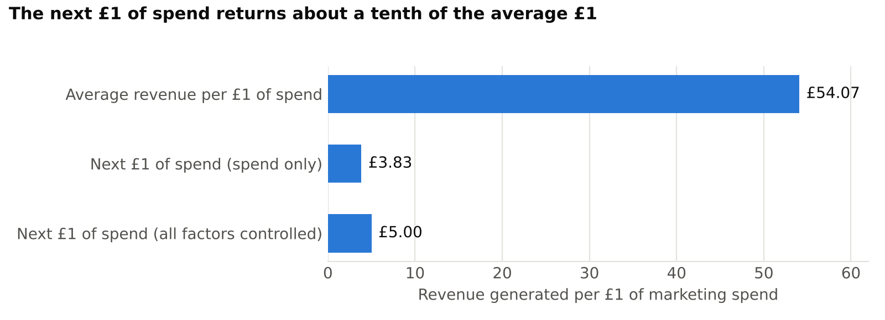
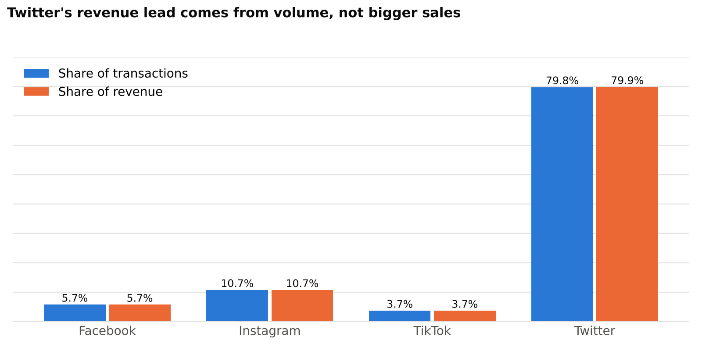
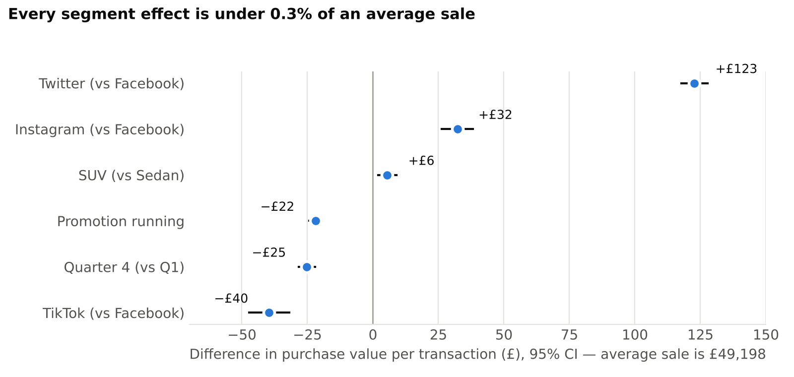

# Marketing ROI & Effectiveness Analysis

**How much does marketing spend really return, and which levers actually move purchase value?**

**Author:** Afolasewa Duduyemi · **Tools:** R (dplyr, ggplot2, broom) · **Methods:** KPI design, ANOVA with effect sizes, multiple regression, marginal-return analysis

## Business question

A business spends on four social channels (Facebook, Instagram, TikTok, Twitter) to sell three
vehicle types. Leadership wants to know whether that spend is efficient and where the next pound
of budget should go.

## Headline findings

| | Result | What it means |
|---|---|---|
| **Average return** | £54.07 of revenue per £1 of spend (portfolio ROMI 53×) | Spend looks extremely profitable on average |
| **Marginal return** | Each **extra** £1 brings in only **£3.83–£5.00** | The next pound earns about a tenth of the average – budget decisions should use this number |
| **Channels** | Twitter carries 80% of transactions and 80% of revenue | Its revenue lead is volume; its average sale is only 0.3% higher than Facebook's |
| **Promotions** | No difference in raw purchase value (p = 0.36); −£22 per sale with controls | No evidence promotions lift sale value |
| **Product, buyer type, quarter** | Each explains about 3% or less of the variation in purchase value | Not useful levers for budget allocation |
| **Commissions** | Strongest single predictor (+£3.29 per £1, r = 0.53) | Worth investigating – but commission likely rises *because* sales are bigger |



### 1. Judge budget on marginal return, not average ROMI
Average ROMI tells you how well past spend did in total; it says nothing about the next pound.
Regressing purchase value on spend gives **£3.83 of extra revenue per extra £1** (£5.00 once channel,
product, buyer, promotion and quarter are controlled), and a spend elasticity of **0.07** – a 10%
rise in spend is associated with a 0.7% rise in purchase value. Spend still pays back at the margin,
but at roughly one-tenth of the headline rate.

> **Correction to the original coursework:** the first version reported that ROMI falls as spend
> rises. That pattern is built into the formula – ROMI = purchase ÷ spend − 1, and purchase value
> barely varies (SD £181 on £49,198), so ROMI tracks 1 ÷ spend almost exactly (r = 0.98). The
> marginal-return analysis above is the correct way to test for diminishing returns.

### 2. Twitter's lead is volume, not quality



Campaign explains 10.9% of the variation in purchase value (η² = 0.109), the largest of any
segment – but in money terms the gaps are small: Twitter sales average £49,227 vs £49,021 on TikTok.
ROMI ranges only from 52.7 (TikTok) to 53.1 (Twitter).

### 3. Effects in context



With 44,359 transactions almost any difference is "statistically significant". Every segment effect
is under 0.3% of an average sale, so none justifies a large budget shift on its own.

## Recommendations

1. **Report marginal ROMI alongside average ROMI** in budget reviews; set spend where the marginal
   return still clears the cost of the next campaign.
2. **Don't move budget to Twitter on this evidence alone** – its efficiency edge is under 1%.
   Run a controlled test (hold-out regions or time periods) before reallocating.
3. **Review the promotion programme** – it shows no revenue lift, so its cost needs separate justification.
4. **Investigate the commission link** with timing data to see whether commission drives sales or
   simply follows them.
5. **Collect profit, not just revenue** – product margins and channel-level costs would turn ROMI
   into a true profitability measure.

## Data

- `data/ev_20.xlsx`: 49,287 transactions provided by my MSc lecturer for a coursework assessment.
  The values appear to be **simulated for teaching**, so findings illustrate method rather than a real company.
- Fields: purchase value, marketing spend, commissions, campaign, product, buyer type, promotion, period (month), sales rep.
- Cleaning removed negative commissions, missing categories and invalid codes ("false", "soon", "tank"),
  and merged "two" into "couple" – **44,359 transactions retained**.
- Caveat: about 24% of `period` values are exactly 12, which suggests capping; quarterly results should be read cautiously.

## Method

| Step | What | Script |
|---|---|---|
| Clean | Validation rules above; transaction-level ROMI | `R/01_clean_data.R` |
| KPIs & segments | Totals-based ROMI; volume/revenue share; ANOVA with η²; Tukey HSD | `R/02_kpis_and_segments.R` |
| Return on spend | Spend-only and fully controlled regressions; log-log elasticity; spend deciles | `R/03_return_on_spend.R` |
| Charts | Figures in `outputs/figures/` | `R/04_charts.R` |

Full model: `purchase ~ marketing + commissions + campaign + promotions + product + buyer + quarter`
(R² = 0.53, n = 44,359).

## How to run

```r
# from the project folder
source("run_all.R")   # installs missing packages, writes tables and charts to outputs/
```

## Repository structure

```
├── run_all.R
├── R/                      # analysis scripts, run in order
├── data/ev_20.xlsx         # teaching dataset
├── docs/
│   ├── marketing_roi_summary.pdf   # one-page brief
│   └── figures/
├── archive/                # original coursework script, report and charts (first version)
└── outputs/                # generated tables and charts (not tracked)
```
